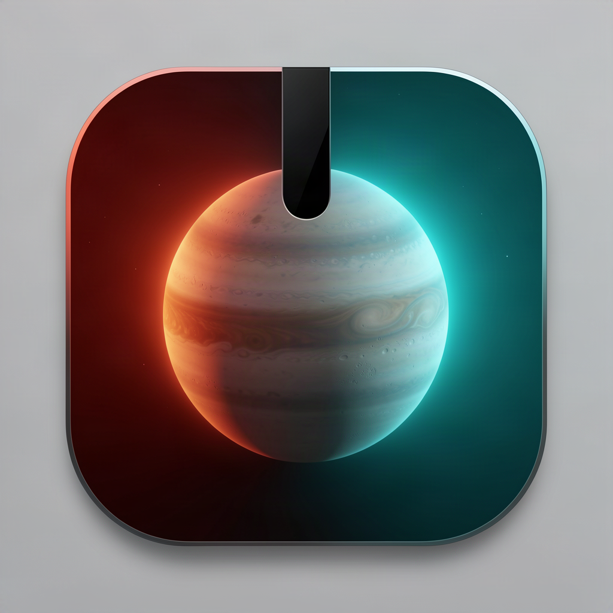

# Gliese

A native macOS notch interface designed for fluid media control, synchronized lyrics, audio routing, and minimal desktop utilities.

<p align="center">
  
</p>

---

## Features

- **Dynamic Notch Media & Lyrics:** Live Now Playing control with multi-source media synchronization (Spotify, Brave, Safari, Apple Music) and real-time inline LRC lyrics.
- **Per-App Audio Mixer:** CoreAudio process tap engine allowing per-application volume sliders, quick muting, and independent output device routing (e.g., Spotify to external DAC, browser to built-in speakers).
- **Ephemeral Clipboard Manager:** Lightweight, session-only clipboard history residing in volatile memory.
- **Transient Shelf:** Drag-and-drop file staging area integrated into the notch.
- **Hardware Telemetry:** Native CPU, memory, battery, and network throughput telemetry with minimal overhead.

---

## Requirements

- macOS 14.0 (Sonoma) or later
- Apple Silicon or Intel Mac
- Xcode 16.0+ (for building from source)

---

## Building from Source

1. Clone the repository:
   ```bash
   git clone https://github.com/Rymaxw/Gliese.git
   cd Gliese
   ```

2. Build and run via Xcode:
   ```bash
   open Gliese.xcodeproj
   ```

3. Or compile directly using command-line tools:
   ```bash
   xcodebuild -project Gliese.xcodeproj -scheme Gliese -configuration Release -destination 'platform=macOS' build
   ```

---

## Architecture

- **`Gliese/`**: SwiftUI and AppKit notch presentation layers, custom window hosting, and menu bar interaction.
- **`GlieseCore/`**: Standalone Swift package containing pure business logic: LRC parsing, timeline interpolation, audio mixer routing policy, media coordinator state machines, and telemetry calculators.
- **`GlieseXPCHelper/`**: Auxiliary service for system-level integrations and window layering.

---

## License

GPL-3.0-or-later
